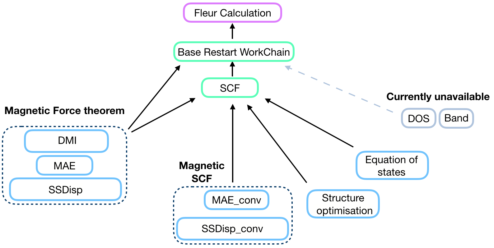

AiiDA-FLEUR WorkChains
======================

General design
++++++++++++++

All of the WorkChains share one interface: the same three ways to say what to compute on
(``structure``, ``fleurinp``, ``remote_data``), the same ``wf_parameters``/``options`` steering
dicts, the same ``inpxml_changes`` mechanism, the same ``output_<wcname>_wc_para`` result node and
the same exit-code allocation.

That shared contract is documented in one place:

.. toctree::
   :maxdepth: 2

   ./using_workflows

Read it first — the pages below document only what is specific to an individual workchain.

Workchain classification
++++++++++++++++++++++++

All of the workchains are divided into the groups. First, we separate *technical* and
*scientific* workflows. This separation is purely subjective: *technical* workchains tend to be
less complex and represent basic routine tasks that people usually encounter. *Scientific*
workflows are less general and aimed at certain tasks.

There are the sub-group of the force theorem calculations
and their self-consistent analogs in the scientific workchains group.

.. note::

    The ``plot_fleur`` function provides a quick visualization for every workflow node or node list.
    Inputs are *uuid*, *pk*, *workchain* nodes or *ParameterData* (workchain output) nodes.

Basic (Technical) Workchains
++++++++++++++++++++++++++++

.. toctree::
   :maxdepth: 2

   ./base_wc
   ./scf_wc
   ./eos_wc
   ./base_relax_wc
   ./relax_wc
   ./dos_band_wc
   ./orbcontrol_wc

More advanced (Scientific) Workchains
+++++++++++++++++++++++++++++++++++++

Advanced workchains can be divided into categories according to subject.

XPS workchains:

.. toctree::
   :maxdepth: 2

   ./initial_cls_wc
   ./corehole_wc

Magnetic workchains:

Magnetic workchains can be divided into two subgroups the Force-theorem subgroup and the self-consistent sub-group.

The Force-theorem subgroup contains:

- ssdisp_wc
- dmi_wc
- mae_wc

The self-consistent sub-group contains:

- ssdisp_conv_wc
- mae_conv_wc

.. toctree::
   :maxdepth: 2

   ./ssdisp_wc
   ./dmi_wc
   ./mae_wc
   ./ssdisp_conv_wc
   ./mae_conv_wc

And other workflows like the  create_magnetic_wc.

.. toctree::
   :maxdepth: 2

   ./create_magnetic_wc
   ./cfcoeff_wc
